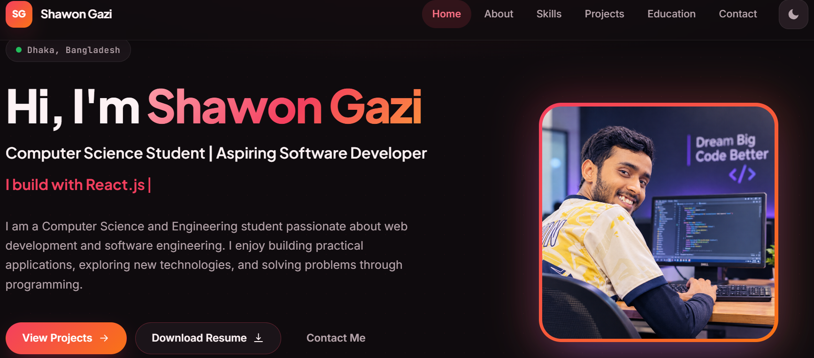

# 👨‍💻 Shawon Gazi — Personal Portfolio

<p align="center">
  
  
  
  
</p>

<p align="center">
  A modern, responsive, and minimalist personal portfolio website showcasing my skills, projects, education, and journey as an aspiring software developer.
</p>

---

## 🌐 Live Preview

🔗 **Live Website:** [Visit My Portfolio](https://gazishawon999.github.io/Shawon-Portfolio)

<!-- Add your portfolio screenshot here after deployment -->

<p align="center">
  
</p>

## 👋 About Me

Hi! I'm **Shawon Gazi**, a Computer Science and Engineering student at Eastern University, Bangladesh, with a passion for web development and software engineering.

I enjoy building practical applications, exploring modern technologies, and continuously improving my programming skills.

I'm currently focusing on strengthening my frontend development skills and exploring full-stack web development.

- 🎓 B.Sc. in Computer Science & Engineering
- 💻 Interested in Web Development & Software Engineering
- 🚀 Passionate about building real-world projects
- 🌱 Currently learning TypeScript, Next.js, and Full Stack Development
- 📍 Dhaka, Bangladesh

## ✨ Features

- 🎨 Modern and minimalist dark-themed design
- 📱 Fully responsive across mobile, tablet, and desktop
- 🌓 Dark/Light theme toggle
- 👨‍💻 Personal introduction and profile section
- 🛠️ Categorized technical skills showcase
- 🚀 Featured projects with live demo and GitHub links
- 🎓 Education and learning journey timeline
- 📬 Contact section with social links
- ✨ Smooth scrolling and subtle animations
- 🔝 Back-to-top functionality
- ⚡ Lightweight and fast performance
- 🔍 SEO-friendly structure

## 🛠️ Tech Stack

| Technology        | Purpose                          |
| ----------------- | -------------------------------- |
| HTML5             | Website Structure                |
| CSS3              | Styling and Responsive Design    |
| JavaScript (ES6+) | Dynamic Content and Interactions |
| Git               | Version Control                  |
| GitHub            | Source Code Management           |

## 📂 Project Structure

```text
Shawon-Portfolio/
│
├── index.html
│
├── css/
│   └── style.css
├── js/
│   ├── data.js
│   ├── script.js
│   └── theme-init.js
├── assets/
│   ├── images/
│   ├── icons/
│   └── Shawon-Gazi-Resume.pdf
│
├── favicon.ico
└── README.md
```

## 🚀 Featured Projects

Here are some of my selected projects:

### 1. StudioSpace

A full-stack workspace and studio booking platform featuring authentication, studio management, booking management, and dashboards.

- **Technologies:** Next.js, TypeScript, Node.js, Express.js, MongoDB, Better Auth
- **Live Demo:** [Visit Website](https://studiospace-client-orpin.vercel.app/)
- **GitHub:** [View Client Side Repository](https://github.com/gazishawon999/studiospace-client)
- **GitHub:** [View Server Side Repository](https://github.com/gazishawon999/studiospace-server)

### 2. BazarDor

A daily market price tracking application that helps users explore products, categories, and market-related information.

- **Technologies:** Next.js, TypeScript, Tailwind CSS
- **Live Demo:** [Visit Website](https://bazar-dor-h23v.vercel.app/)
- **GitHub:** [View Repository](https://github.com/gazishawon999/bazar-dor)

### 3. Dev Stack Builder

A React-based technology catalog application developed as part of my Programming Hero assignment.

- **Technologies:** React, TypeScript, Vite, Tailwind CSS
- **Live Demo:** [Visit Website](https://b14-a05-react-git-main-gazishawon999.vercel.app/)

<!-- ### 4. Circling the Globe

A university database management system project featuring country-related information, interactive quizzes, user authentication, and database integration.

- **Technologies:** React, Node.js, SQL -->

## 📚 Currently Learning

- TypeScript
- Next.js
- Advanced JavaScript
- Full Stack Web Development
- Backend Development
- Database Management

## ⚙️ Getting Started

Follow these steps to run the project locally.

**1. Clone the repository**

```bash
git clone https://github.com/gazishawon999/Shawon-Portfolio.git
```

**2. Navigate to the project directory**

```bash
cd Shawon-Portfolio
```

**3. Open the project**

Open the folder in Visual Studio Code.

**4. Run the website**

Use the VS Code Live Server extension to launch `index.html`.

Alternatively, use any local static development server that supports JavaScript ES Modules.

## ✏️ Customization

The portfolio uses a data-driven structure to make content management easier.

You can update most personal information by editing:

```text
js/data.js
```

You can customize:

- Personal information
- Professional headline
- About Me description
- Technical skills
- Education
- Projects
- Social media links

**Profile Image:**

Replace the existing image with your own photograph at:

```text
assets/images/profile.jpg
```

**Resume:**

Replace the resume file at:

```text
assets/Shawon-Gazi-Resume.pdf
```

**Project Images:**

Add or replace project screenshots inside:

```text
assets/images/
```

## 🌍 Deployment

This project can be deployed using **GitHub Pages**.

1. Push the project to your GitHub repository.
2. Open the repository's Settings.
3. Navigate to Pages.
4. Select Deploy from a branch.
5. Choose the `main` branch and `/ (root)` directory.
6. Click Save.

Your portfolio will be published using GitHub Pages.

## 📬 Connect With Me

<p align="left">
  <a href="https://github.com/gazishawon999">
    
  </a>
  <a href="https://www.linkedin.com/in/gazishawon999/">
    
  </a>
  <a href="mailto:gazishawon999@gmail.com">
    
  </a>
</p>

- **Email:** gazishawon999@gmail.com
- **GitHub:** [gazishawon999](https://github.com/gazishawon999/)
- **LinkedIn:** [Shawon Gazi](https://www.linkedin.com/in/gazishawon999/)

---

<p align="center">
  Designed & Developed with ❤️ by <strong>Shawon Gazi</strong>
  <br />
  <sub>Learning, Building, and Growing Every Day.</sub>
</p>
